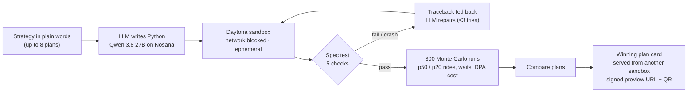

# 並ばない Narabanai — "Don't queue"

**Don't trust AI-written code. Verify it.**
Narabanai turns a plain-language Tokyo Disneyland touring strategy into Python with an LLM, rejects it unless it passes a spec test, and then runs 300 Monte Carlo simulations of the day inside **parallel, network-isolated, ephemeral Daytona sandboxes**. When the generated code crashes, the LLM reads the traceback and repairs it. The winning plan is served from another Daytona sandbox as a phone page behind a QR code. The code-writing model is **Qwen 3.8 27B, self-hosted on Nosana**.

> 自然言語の回り方を LLM が Python にし、仕様テストを通ったものだけを、ネットワーク遮断・使い捨ての Daytona Sandbox で 300 回並列シミュレーション。落ちたらエラーを読んで自力修復し、最優秀プランは別の Sandbox から QR コードで配信します。コードを書くモデルは Nosana 上の Qwen 3.8 27B です。

## Why

Everyone can make an LLM write code. The hard part is running that code without trusting it. A family planning a Disney day asks a fuzzy question ("buy Premier Access for the top two rides, then go wherever is emptiest — worth ¥18,000?"). Narabanai answers it with **evidence**: each strategy becomes executable code that is gated, isolated, stress-tested 300 times, and compared on the same footing.

## How it works



1. **Write**: each plan is sent to the LLM with a strict contract: define `choose(now, remaining, location, est_wait)` and optionally `DPA` / `LUNCH_AT`, using the standard library only.
2. **Gate**: the spec test checks that `choose()` exists, returns only valid ride names, finishes before closing, runs fast enough, and buys at most 2 DPAs. Code that fails never gets to the simulation.
3. **Isolate and simulate**: the code plus the simulation engine are sent into a fresh Daytona sandbox with all network blocked, and 300 simulated days are run there.
4. **Repair**: on a crash, the last 1,500 characters of the traceback go back to the LLM, which rewrites the code (up to 3 attempts). If the LLM itself is down, a preset strategy runs instead so the demo never shows a blank screen.
5. **Share**: the best plan becomes a phone-ready "plan card" served from a separate sandbox through a signed preview URL, shown as a QR code that judges can scan.

## How we use Daytona

Daytona is the trust boundary of the whole product, not just a place to run code.

| Feature | Where | Why it matters here |
|---|---|---|
| `network_block_all=True` | `core.new_sandbox` | AI-written code cannot exfiltrate data or call home. |
| `ephemeral=True` + `ttl_minutes=10` + `auto_stop_interval=5` | `core.new_sandbox` | One sandbox per plan per run, destroyed after use; a hung sandbox is still reclaimed within 10 minutes. |
| Parallel fan-out | `server.start_job` | Up to 8 plans run side by side, one sandbox each (fits Tier 1: 10 vCPU / 10 GiB). |
| `process.code_run` | `core.worker` | Runs engine and AI code together and returns exit code and output for the repair loop. |
| Labels + `list()` / `delete()` | `core.sweep`, `core.live_sandboxes` | Leftovers from a previous run are cleaned on startup; the UI shows sandboxes appearing and disappearing live. |
| Sessions + `create_signed_preview_url` | `core.publish_card` | The plan card is served by `python3 -m http.server` inside a sandbox and reached through a 1-hour signed URL, so no hosting is needed. |
| KVM sandboxes (`kvm=True`) with fallback | `core.new_sandbox` | Stronger isolation when the tier allows it; on Tier 1 Daytona returns `DaytonaForbiddenError`, and the app falls back automatically. |

**Isolation proof ("攻撃してみる", `SHOW_PROBES=1`)**: three real attack scripts run in network-blocked sandboxes and the UI shows that each one is stopped:

- sending data to the internet;
- reading API keys from environment variables (the keys stay on the host);
- stealing cloud credentials from the AWS/GCP metadata API and reaching internal hosts.

The scripts only test our own sandboxes and touch nothing outside them.

## How we use Nosana

The LLM that writes the strategy code is **Qwen 3.8 27B** (AWQ 4-bit, vLLM, 128K context, up to 8 concurrent requests), deployed from Nosana's official template on an **NVIDIA RTX PRO 6000 (96 GB)**. vLLM exposes an OpenAI-compatible `/v1/chat/completions` endpoint, so Narabanai talks to it with nothing more than `LLM_BASE_URL` / `LLM_MODEL`. The model's thinking mode is turned off through `LLM_EXTRA` so the whole token budget goes to code. The parallel plans hit the endpoint concurrently, which is why we picked the variant that supports 8 concurrent requests.

Any OpenAI-compatible endpoint works. Setting `LLM_PROVIDER=anthropic` switches to Claude instead. Only one LLM is used at a time.

## Measured on 2026-11-15

- 8 plans in one run: 8 Daytona sandboxes created in parallel, about 2 s boot each; all 8 passed the spec test and ran 300 simulations each.
- Fault injection: plan B was deliberately given broken code (`KeyError: 'nmae'`); Qwen read the traceback and fixed it on the first retry.
- Example result (weekend crowd, family of 4): DPA for the top two rides gives 17–18 rides versus 12–16 without, so the money buys about 1–2 extra rides for ¥18,000.
- End-to-end run with Qwen on Nosana: about 40–60 s for 3 plans.
- KVM requested on Tier 1 → `DaytonaForbiddenError` → automatic fallback to standard sandboxes, verified.

## Run it

```bash
pip install daytona anthropic
# create .env as shown below
python presets.py                  # local self-check, no Daytona needed → prints results
python test_core.py                # failure-path checks → OK
python server.py                   # open http://localhost:8000
```

`.env` is read automatically at startup:

```bash
DAYTONA_API_KEY=...

LLM_PROVIDER=openai                # one LLM only: openai (default, any OpenAI-compatible API) | anthropic
LLM_BASE_URL=https://<your-nosana-endpoint>/v1
LLM_MODEL=qwen3.8-27b
LLM_LABEL=Nosana · Qwen 3.8 27B    # name shown in the UI
LLM_API_KEY=                       # empty for a self-hosted vLLM without auth
LLM_EXTRA={"chat_template_kwargs":{"enable_thinking":false}}

ANTHROPIC_API_KEY=...              # only when LLM_PROVIDER=anthropic
```

Optional settings: `LLM_TIMEOUT=90`, `LLM_MAX_TOKENS=3000`, `FANOUT_MAX=8`, `CARD_TTL_MIN=2`, `SHOW_PROBES=1`, `NARABANAI_KVM=1`.

Without any LLM configured the app still runs: turn off "AI がコードを書く" and the preset strategies are used.

## Use it from an agent

`SKILL.md` is an Agent Skill that lets Claude or another agent drive the same API (`POST /api/run`, `GET /api/jobs/<id>`, `POST /api/share`) to answer "is DPA worth it?" with simulated evidence.

## Files

| File | Role |
|---|---|
| `engine.py` | Simulation engine and spec test; shipped into the sandbox together with the AI code |
| `presets.py` | Three preset strategies (fallback when AI is off or fails) |
| `attractions.csv` | Sample data: wait times and DPA prices |
| `core.py` | Sandbox orchestration, LLM calls, fault injection, isolation probes, plan-card hosting |
| `server.py` | Standard-library HTTP server for the page and API |
| `web/` | Prebuilt React page (React Flow), no CDN needed on site |
| `ui/` | React source. Rebuild with `npm i && npx esbuild app.jsx --bundle --minify --outfile=../web/app.js --define:process.env.NODE_ENV='"production"'` |
| `SKILL.md` | Agent Skill |
| `test_core.py` | Failure-path checks |

Wait times and DPA prices are sample data for the demo. Every AI-written strategy passes the spec test and runs in a network-blocked Daytona sandbox.
