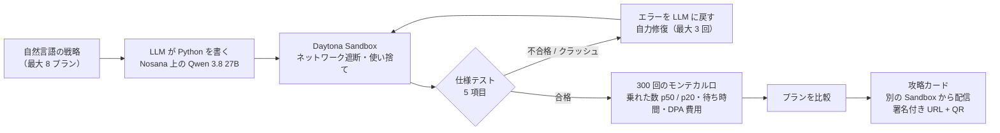

# 並ばない Narabanai

**AI が書いたコードは信じない。検証する。**

東京ディズニーランドの回り方を自然言語で書くと、LLM がそれを Python にします。仕様テストを通ったコードだけを、**ネットワーク遮断・使い捨ての Daytona Sandbox** で並列に動かし、1 日を 300 回モンテカルロ・シミュレーションします。生成コードが落ちたら、LLM がエラーを読んで自力で修復します。最優秀プランは別の Daytona Sandbox からスマホ用ページとして配信し、QR コードで持ち帰れます。コードを書くモデルは **Nosana 上にセルフホストした Qwen 3.8 27B** です。

English version: [README.en.md](README.en.md)

## なぜ作ったか

LLM にコードを書かせるのは誰でもできます。難しいのは、そのコードを**信用せずに**実行することです。ディズニーに行く家族の疑問は曖昧です。「人気トップ 2 はプレミアアクセス（DPA）を買って、あとは空いている順。¥18,000 払う価値はある？」Narabanai はこれに**証拠**で答えます。どの戦略も実行可能なコードになり、門前払いの検査・隔離・300 回のストレステストを経て、同じ条件で比べられます。

## 仕組み



1. **書く**: 各プランを厳密な約束つきで LLM に渡します。`choose(now, remaining, location, est_wait)` を定義すること、必要なら `DPA` / `LUNCH_AT` を置くこと、標準ライブラリのみ使うこと。
2. **門前払い**: 仕様テストで次の 5 点を確認します。不合格のコードはシミュレーションに進めません。
   - `choose()` が定義されている
   - 有効な項目名だけを返す
   - 閉園までに終わる
   - 十分に速い
   - DPA は 2 件まで
3. **隔離して検証**: AI のコードとシミュレーションエンジンを、ネットワークを完全に遮断した新しい Daytona Sandbox に入れて、300 日分を実行します。
4. **自力修復**: クラッシュしたら、エラーの末尾 1,500 文字を LLM に戻して書き直させます（最大 3 回）。LLM 自体が落ちた場合はプリセット戦略で代走するので、デモが空画面になりません。
5. **配信**: 最優秀プランを、別の Sandbox からスマホ用の「攻略カード」として配信します。署名付きプレビュー URL を QR コードにして画面に出すので、評価者はその場でスキャンできます。

## Daytona の使い方

Daytona はコードを動かす場所であると同時に、このプロダクトの**信頼の境界**です。

| 機能 | 場所 | ここでの意味 |
|---|---|---|
| `network_block_all=True` | `core.new_sandbox` | AI が書いたコードはデータを外に送れない |
| `ephemeral=True` + `ttl_minutes=10` + `auto_stop_interval=5` | `core.new_sandbox` | 1 回の実行につき 1 プラン 1 Sandbox で、使い終わったら破棄。固まっても 10 分以内に必ず回収 |
| 並列ファンアウト | `server.start_job` | 最大 8 プランを 1 プラン 1 Sandbox で同時実行（Tier 1 の 10 vCPU / 10 GiB に収まる） |
| `process.code_run` | `core.worker` | エンジンと AI のコードを一緒に実行し、終了コードと出力を修復ループに返す |
| ラベル + `list()` / `delete()` | `core.sweep`、`core.live_sandboxes` | 起動時に前回の残骸を掃除。Sandbox が生えて消える様子を画面にライブ表示 |
| セッション + `create_signed_preview_url` | `core.publish_card` | Sandbox 内の `python3 -m http.server` が攻略カードを配信し、1 時間有効の署名付き URL で公開。別のホスティングは不要 |
| KVM Sandbox（`kvm=True`）と自動フォールバック | `core.new_sandbox` | Tier が許せばより強い隔離。Tier 1 では `DaytonaForbiddenError` が返り、自動で通常の Sandbox に切り替わる |

**隔離の証明（「攻撃してみる」、`SHOW_PROBES=1`）**: 本物の攻撃コード 3 本をネットワーク遮断の Sandbox で実行し、すべて防がれることを画面で見せます。

- 外部へのデータ送信
- 環境変数からの API キーの窃取（キーはホスト側にだけあり、Sandbox には渡さない）
- AWS / GCP のメタデータ API からのクラウド認証情報の窃取と、内部ホストへの到達

どれも自分たちの Sandbox の隔離を確かめるだけで、外部には何もしません。

## Nosana の使い方

戦略コードを書く LLM は **Qwen 3.8 27B** です。Nosana 公式テンプレートから、AWQ 4-bit・vLLM・128K コンテキスト（同時 8 リクエスト）の構成で、**NVIDIA RTX PRO 6000（96 GB）** にデプロイしました。vLLM は OpenAI 互換の `/v1/chat/completions` を出すので、Narabanai 側は `LLM_BASE_URL` / `LLM_MODEL` を設定するだけで繋がります。モデルの思考モードは `LLM_EXTRA` で切り、トークンをすべてコードに使わせます。複数プランが同時にエンドポイントを叩くため、同時 8 リクエストに対応する構成を選びました。

OpenAI 互換のエンドポイントなら何でも使えます。`LLM_PROVIDER=anthropic` にすれば Claude に切り替わります。同時に使う LLM は 1 つだけです。

## 実測（2026-11-15）

- 1 回で 8 プラン: Daytona Sandbox 8 個を並列に作成し、起動は各約 2 秒。8 個すべてが仕様テストに合格し、それぞれ 300 回のシミュレーションを完走。
- 故障注入: プラン B にわざと壊れたコード（`KeyError: 'nmae'`）を入れたところ、Qwen がエラーを読んで 1 回目の修正で直した。
- 結果の例（週末・4 人家族）: 人気トップ 2 に DPA を使うと 17〜18 アトラクション、使わないと 12〜16。¥18,000 で増えるのは 1〜2 個。
- Nosana 上の Qwen での実行: 3 プランで全体 約 40〜60 秒。
- Tier 1 で KVM を要求 → `DaytonaForbiddenError` → 通常の Sandbox への自動フォールバックを確認。

## 動かし方

```bash
pip install daytona anthropic
cp .env.example .env               # 値を入れる
python presets.py                  # ローカル自己チェック（Daytona 不要）→ 結果を表示
python test_core.py                # 失敗パスのチェック → OK
python server.py                   # http://localhost:8000 を開く
```

`.env` は起動時に自動で読み込まれます。

```bash
DAYTONA_API_KEY=...

LLM_PROVIDER=openai                # LLM は 1 つだけ: openai（既定、OpenAI 互換 API なら何でも）| anthropic
LLM_BASE_URL=https://<your-nosana-endpoint>/v1
LLM_MODEL=qwen3.8-27b
LLM_LABEL=Nosana · Qwen 3.8 27B    # 画面に出す名前
LLM_API_KEY=                       # 認証なしのセルフホスト vLLM なら空
LLM_EXTRA={"chat_template_kwargs":{"enable_thinking":false}}

ANTHROPIC_API_KEY=...              # LLM_PROVIDER=anthropic のときだけ必要
```

任意の設定: `LLM_TIMEOUT=90`、`LLM_MAX_TOKENS=3000`、`FANOUT_MAX=8`、`CARD_TTL_MIN=2`、`SHOW_PROBES=1`、`NARABANAI_KVM=1`。

LLM を設定しなくても動きます。「AI がコードを書く」を切れば、プリセット戦略で実行します。

## エージェントから使う

`SKILL.md` は Agent Skill です。Claude などのエージェントが同じ API（`POST /api/run`、`GET /api/jobs/<id>`、`POST /api/share`）を使い、「DPA は買う価値がある？」にシミュレーションの証拠で答えられます。

## ファイル

| ファイル | 役割 |
|---|---|
| `engine.py` | シミュレーションエンジンと仕様テスト。AI のコードと一緒に Sandbox に送る |
| `presets.py` | プリセット戦略 3 本（AI オフ時・生成失敗時の保険） |
| `attractions.csv` | サンプルデータ（待ち時間、DPA 料金） |
| `core.py` | Sandbox の編成、LLM 呼び出し、故障注入、隔離の証明、攻略カードの配信 |
| `server.py` | 標準ライブラリの HTTP サーバー（画面と API） |
| `web/` | ビルド済みの React 画面（React Flow）。現地で CDN に依存しない |
| `ui/` | React のソース。画面を変えたら ui/ で `npm i && npx esbuild app.jsx --bundle --minify --outfile=../web/app.js --define:process.env.NODE_ENV='"production"'` |
| `SKILL.md` | Agent Skill |
| `test_core.py` | 失敗パスのチェック |

待ち時間と DPA 料金はデモ用のサンプルデータです。AI が書いた戦略はすべて仕様テストを通し、ネットワーク遮断の Daytona Sandbox で実行しています。
